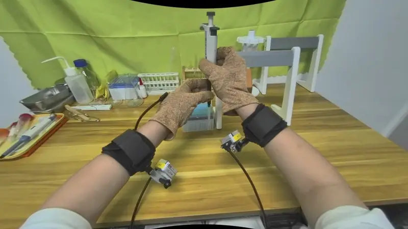

<h2 align="center"> <a href="https://arxiv.org/abs/2610.10288">TouchScale: 500 Hours of Human Vision and Touch for Visual–Tactile Learning</a></h2>

<p align="center">
Dayou Li<sup>1,*</sup>, Hao Wang<sup>2,*</sup>, Qianqian Yang<sup>3,*</sup>, Zihao Zhu<sup>1,*</sup>, Haoquan Fang<sup>4</sup>, Ziyao Zeng<sup>5</sup>, Yan Han<sup>6</sup>, Zihan Wang<sup>7</sup>, Yan Wang<sup>8</sup>,
Baoru Huang<sup>9</sup>, Dilin Wang<sup>10</sup>, Kenji Shimada<sup>3</sup>, Yiyue Luo<sup>11</sup>, Manling Li<sup>12</sup>, Teresa Lv<sup>13</sup>, Mustafa Mukadam<sup>11</sup>, Rakesh Ranjan<sup>10</sup>,
Ruohan Zhang<sup>4</sup>, Qi He<sup>6</sup>, Changliu Liu<sup>3</sup>, Xu Chen<sup>11</sup>, Marco Pavone<sup>4,8</sup>, Bangya Liu<sup>7</sup>, Jiachen Li<sup>14</sup>, Masayoshi Tomizuka<sup>15</sup>, Zhiwen Fan<sup>1,†</sup>
</p>

<p align="center">
<sup>1</sup>Texas A&amp;M University&nbsp;&nbsp; <sup>2</sup>Google DeepMind&nbsp;&nbsp; <sup>3</sup>CMU&nbsp;&nbsp; <sup>4</sup>Stanford University&nbsp;&nbsp; <sup>5</sup>Yale University&nbsp;&nbsp;
<sup>6</sup>Microsoft&nbsp;&nbsp; <sup>7</sup>Overfit Lab&nbsp;&nbsp; <sup>8</sup>NVIDIA&nbsp;&nbsp; <sup>9</sup>University of Liverpool&nbsp;&nbsp; <sup>10</sup>Meta&nbsp;&nbsp;
<sup>11</sup>University of Washington&nbsp;&nbsp; <sup>12</sup>Northwestern University&nbsp;&nbsp; <sup>13</sup>Sony&nbsp;&nbsp; <sup>14</sup>Georgia Tech&nbsp;&nbsp; <sup>15</sup>UC Berkeley
<br>
<sup>*</sup>Equal contribution&nbsp;&nbsp; <sup>†</sup>Corresponding author
</p>

<h5 align="center">

[](https://arxiv.org/abs/2610.10288)
[](https://touch-scale.github.io/)
[](https://huggingface.co/datasets/2077AIDataFoundation/TouchScale)
[](https://www.overfitlab.ai/research/touchscale)

</h5>

<div align="center">
This repository is the official implementation of TouchScale.
TouchScale provides 500 hours of egocentric human vision and touch, and mid-training on it teaches a robot policy to predict how touch will change before robot post-training.
</div>
<br>

## Table of Contents

- [Table of Contents](#table-of-contents)
- [Updates](#updates)
- [Overview](#overview)
  - [Scale and Task Diversity](#scale-and-task-diversity)
  - [Data Collection Setup](#data-collection-setup)
  - [Mid-training Results](#mid-training-results)
- [Get Started](#get-started)
  - [Repository Structure](#repository-structure)
  - [Data Quality Control](#data-quality-control)
  - [N0-VTLA Mid-training and Post-training](#n0-vtla-mid-training-and-post-training)
- [Acknowledgement](#acknowledgement)
- [License](#license)
- [Citation](#citation)

## Updates

**[2026-10-08]** Released N0-VTLA with TouchScale mid-training and robot post-training. See [n0-vtla/docs/MID_TRAIN.md](n0-vtla/docs/MID_TRAIN.md) and [n0-vtla/docs/POST_TRAIN.md](n0-vtla/docs/POST_TRAIN.md).

**[2026-10-07]** The TouchScale paper is available on [arXiv](https://arxiv.org/abs/2610.10288).

**[2026-10-04]** Released the TouchScale data quality-control pipeline. See [qc/README.md](qc/README.md).

## Overview

### Scale and Task Diversity

<p align="center">
  <a href="https://touch-scale.github.io/"></a>
  <br>
  <em>500 hours across laboratories, kitchens, workbenches, and everyday environments.</em>
</p>

### Data Collection Setup

TouchScale is a large-scale egocentric visual-tactile dataset of everyday
manipulation, recorded in laboratories, kitchens, workbenches, and other
everyday environments. A single wearable setup records:

- a head-mounted **RGB-D camera** for the overall interaction,
- two **wrist-mounted RGB cameras** for close views of hand-object contact (both at 30 Hz),
- bimanual **tactile gloves**, each with 880 taxels across the five fingers and
  palm at under 2 mm spatial resolution, recording normal and shear force.

### Mid-training Results

Mid-training on TouchScale teaches a policy to predict how touch will change
before robot post-training. In real-robot experiments this raised task success
from 22.5% to 57.5% on contact-rich tasks (soft/hard sorting, bottle-cap removal,
test-tube transfer, whiteboard wiping). Scaling the data also improves zero-shot
tactile contact prediction and egocentric action recognition.

## Get Started

### Repository Structure

| Path | Description |
|---|---|
| [`qc/`](qc/) | The automatic data-quality pipeline used to screen recordings: a timestamp sync gate across all six sensor streams, and a VLM-assisted check for missing tactile signal and baseline noise. See [`qc/README.md`](qc/README.md). |
| [`n0-vtla/`](n0-vtla/) | The visual–tactile–action policy (a derivative of [NeoteAI's N0-VTLA](https://github.com/neoteai/N0-VTLA)) with the TouchScale additions: action-free **mid-training** of the tactile branch on human TouchScale data, and **post-training** on your own robot recordings (data conversion, normalization scripts, launcher, real-robot inference notes). Start with [`n0-vtla/docs/MID_TRAIN.md`](n0-vtla/docs/MID_TRAIN.md) and [`n0-vtla/docs/POST_TRAIN.md`](n0-vtla/docs/POST_TRAIN.md). |

### Data Quality Control

Full details are in [qc/README.md](qc/README.md).

1. **Install dependencies** (requires `ffmpeg` / `ffprobe`):
   ```bash
   cd qc
   pip install -r requirements.txt
   ```

2. **Check timestamp sync across the sensor streams:**
   ```bash
   python check_sync.py --root /path/to/recordings
   ```

3. **Run the tactile QC** (add a Gemini API key to `.env` first):
   ```bash
   cp .env.example .env
   python run_qc.py --data /path/to/recordings --out qc_out
   ```

### N0-VTLA Mid-training and Post-training

Checkpoints are expected to live in a `checkpoints/` folder next to `n0-vtla/`.

1. **Install the environment:** follow [n0-vtla/docs/INSTALL.md](n0-vtla/docs/INSTALL.md).

2. **Download the original N0-VTLA weights:**
   ```bash
   cd n0-vtla
   hf download NeoteAI/n0-vtla-base --local-dir ../checkpoints/n0-vtla-base
   ```

3. **Mid-train the tactile branch on TouchScale recordings** (details: [n0-vtla/docs/MID_TRAIN.md](n0-vtla/docs/MID_TRAIN.md)):
   ```bash
   python scripts/build_per_task_scale_normalization.py --raw-root /path/to/touchscale_raw --out per_task_scale.json --workers 16
   VTLA_ITW_RAW_ROOT=/path/to/touchscale_raw VTLA_ITW_NORMALIZATION=$PWD/per_task_scale.json \
     VTLA_PRETRAINED_CHECKPOINT=$PWD/../checkpoints/n0-vtla-base bash train_stage1.sh
   ```

4. **Convert your robot recordings, then post-train** (details: [n0-vtla/docs/POST_TRAIN.md](n0-vtla/docs/POST_TRAIN.md)):
   ```bash
   # INIT=original   starts from the original checkpoint
   # INIT=touchscale starts from the original checkpoint + the mid-training result of step 3
   INIT=touchscale DATASET=/path/to/canonical_dataset ASSET_ID=my_asset bash scripts/posttrain.sh
   ```

## Acknowledgement

This work is built on many amazing research works and open-source projects, thanks a lot to all the authors for sharing!

- [N0-VTLA](https://github.com/neoteai/N0-VTLA)

## License

Code in this repository is released under the [MIT License](LICENSE), with one exception: the `n0-vtla/` directory is derived from [NeoteAI's N0-VTLA](https://github.com/neoteai/N0-VTLA) and remains under its original [CC BY-SA 4.0 license](n0-vtla/LICENSE) (third-party notices in `n0-vtla/NOTICE` and `n0-vtla/LICENSES/`). The N0-VTLA model weights are governed by the Gemma Terms of Use.

## Citation

If you find our work useful in your research, please consider giving a star :star: and citing the following paper :pencil:.

```bibtex
@misc{li2026touchscale500hourshuman,
      title={TouchScale: 500 Hours of Human Vision and Touch for Visual-Tactile Learning},
      author={Dayou Li and Hao Wang and Qianqian Yang and Zihao Zhu and Haoquan Fang and Ziyao Zeng and Yan Han and Zihan Wang and Yan Wang and Baoru Huang and Dilin Wang and Kenji Shimada and Yiyue Luo and Manling Li and Teresa Lv and Mustafa Mukadam and Rakesh Ranjan and Ruohan Zhang and Qi He and Changliu Liu and Xu Chen and Marco Pavone and Bangya Liu and Jiachen Li and Masayoshi Tomizuka and Zhiwen Fan},
      year={2026},
      eprint={2610.10288},
      archivePrefix={arXiv},
      primaryClass={cs.CV},
      url={https://arxiv.org/abs/2610.10288},
}
```
